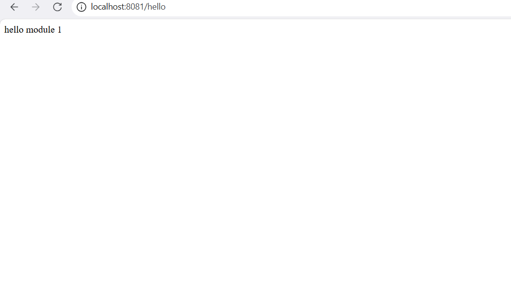

# Module 1: Làm quen với Spring Boot (Getting Started with Spring Boot)

## 1. Tổng quan

Module 1 giới thiệu những kiến thức nền tảng về Spring Boot và hướng dẫn xây dựng ứng dụng Spring Boot đầu tiên.

Mục tiêu của module là hiểu cách khởi tạo một dự án Spring Boot, cấu trúc cơ bản của dự án, cơ chế khởi chạy ứng dụng và cách xây dựng một REST API đơn giản.

## 2. Mục tiêu học tập

Sau khi hoàn thành module này, có thể:

- Hiểu Spring Boot là gì và những ưu điểm của Spring Boot.
- Hiểu Spring Boot Starter và cơ chế Auto Configuration.
- Biết cách khởi tạo dự án bằng Spring Initializr.
- Nắm được cấu trúc thư mục cơ bản của một dự án Spring Boot.
- Hiểu vai trò của annotation `@SpringBootApplication`.
- Biết cách khởi chạy ứng dụng Spring Boot.
- Xây dựng và kiểm tra REST API đầu tiên.

## 3. Công nghệ sử dụng

| Công nghệ | Vai trò |
|---|---|
| Java 21 | Ngôn ngữ lập trình |
| Spring Boot | Framework xây dựng ứng dụng backend |
| Maven | Quản lý thư viện và build dự án |
| Spring Web | Hỗ trợ xây dựng REST API |

## 4. Khởi tạo dự án

Dự án được khởi tạo bằng công cụ [Spring Initializr](https://start.spring.io/).

**Cấu hình dự án:**

- Project: Maven
- Language: Java
- Group: `com.employee`
- Artifact: `employee-management`
- Name: `employee-management`
- Package name: `com.employee.management`
- Packaging: Jar
- Java: 21

**Dependencies:**
- Spring Web

## 5. Cấu trúc dự án

```text
employee-management/
├── .mvn/
├── src/
│   ├── main/
│   │   ├── java/
│   │   │   └── com/
│   │   │       └── employee/
│   │   │           └── management/
│   │   │               ├── EmployeeManagementApplication.java
│   │   │               └── controller/
│   │   │                   └── HelloController.java
│   │   └── resources/
│   │       ├── static/
│   │       ├── templates/
│   │       └── application.properties
│   └── test/
├── .gitignore
├── mvnw
├── mvnw.cmd
└── pom.xml
```

**Một số thành phần quan trọng:**

- `src/main/java`: Chứa mã nguồn Java của ứng dụng.
- `src/main/resources`: Chứa các tài nguyên và file cấu hình.
- `application.properties`: Cấu hình ứng dụng như port, database và các thuộc tính khác.
- `pom.xml`: Khai báo dependencies và cấu hình Maven.
- `src/test`: Chứa mã nguồn phục vụ kiểm thử.

## 6. Nội dung thực hành

### 6.1. Tìm hiểu lớp khởi chạy ứng dụng

File `EmployeeManagementApplication.java` là điểm bắt đầu của ứng dụng Spring Boot.

Annotation `@SpringBootApplication` kết hợp ba annotation quan trọng:

- `@SpringBootConfiguration`: Đánh dấu lớp cấu hình của ứng dụng.
- `@EnableAutoConfiguration`: Cho phép Spring Boot tự động cấu hình ứng dụng dựa trên dependencies và các thiết lập hiện có.
- `@ComponentScan`: Cho phép Spring tìm kiếm và đăng ký các component trong phạm vi quét.

### 6.2. Xây dựng REST API đầu tiên

Tạo file `HelloController.java` trong package `controller`.

```java
package com.employee.management.controller;

import org.springframework.web.bind.annotation.GetMapping;
import org.springframework.web.bind.annotation.RestController;

@RestController
public class HelloController {

    @GetMapping("/hello")
    public String hello() {
        return "Hello! Employee Management System is running.";
    }
}
```

**Giải thích:**

- `@RestController`: Đánh dấu lớp là REST Controller. Dữ liệu trả về từ phương thức được ghi trực tiếp vào HTTP Response Body.
- `@GetMapping("/hello")`: Ánh xạ HTTP GET request đến endpoint `/hello`.
- `hello()`: Phương thức xử lý request và trả về thông báo xác nhận ứng dụng đang hoạt động.

## 7. Chạy ứng dụng

Sử dụng Maven Wrapper để khởi chạy ứng dụng.

**Trên Windows PowerShell:**

```powershell
.\mvnw.cmd spring-boot:run
```

Mặc định, ứng dụng Spring Boot chạy trên cổng `8080`.

## 8. Kiểm thử API

**Thông tin API:**

| Thuộc tính | Giá trị |
|---|---|
| Method | GET |
| Endpoint | `/hello` |
| URL | `http://localhost:8080/hello` |

**Kết quả mong đợi:**

```text
Hello! Employee Management System is running.
```

Có thể kiểm tra API bằng trình duyệt, Postman hoặc các công cụ gửi HTTP request khác.

## 9. Kết quả đạt được

Sau khi hoàn thành Module 1:

- Khởi tạo thành công dự án Spring Boot bằng Spring Initializr.
- Hiểu cấu trúc cơ bản của một dự án Spring Boot.
- Nắm được vai trò của `@SpringBootApplication`.
- Hiểu cơ bản về Starter và Auto Configuration.
- Khởi chạy thành công ứng dụng Spring Boot.
- Xây dựng và kiểm thử thành công REST API `/hello`.

## 10. Trạng thái

- **Trạng thái:** Hoàn thành
- **Branch:** `main`
- **Pull Request:** Không áp dụng (Module 1 được đẩy trực tiếp lên `main`).

---

*Module tiếp theo: Module 2 – Custom Bean & IoC.*